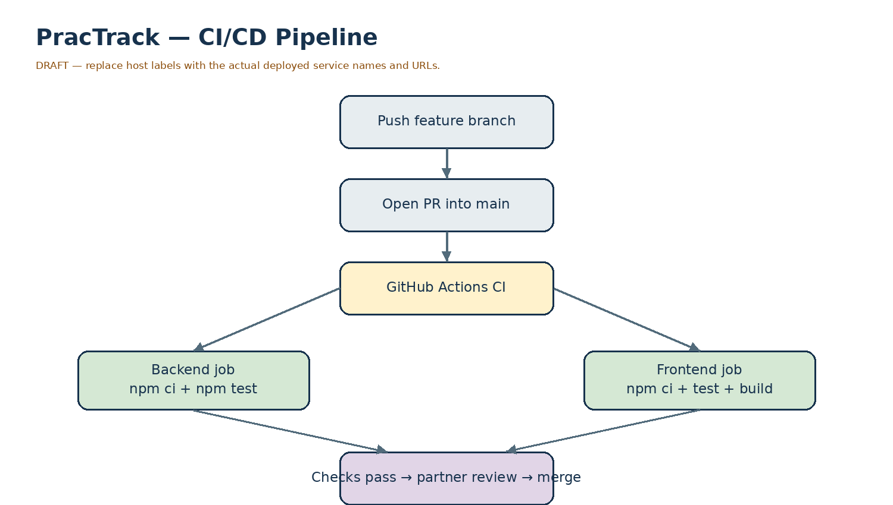

# PracTrack

**Practicum Hours & Verification System**

PracTrack is a web-based practicum management system designed for students and school administrators. It allows students to record their OJT attendance, monitor their completed hours, and submit records for verification. Administrators can manage student accounts, review attendance, organize schedules, and monitor progress toward the required 240 practicum hours.

## Live Links

| Service | URL |
|---|---|
| GitHub Repository | https://github.com/kimilouie3000/Practrack |
| Live Frontend (Netlify) | https://practrack.netlify.app |
| Backend Health Check (Render) | https://practrack.onrender.com/api/health |

## Team

| Member | Role |
|---|---|
| [Member A — Full Name] | Frontend and Interface Lead |
| [Member B — Full Name] | Backend and Pipeline Lead |

**Course:** IPT 102 — Integrative Programming and Technologies 2  
**Project:** PracTrack — Practicum Hours & Verification System

## Tech Stack

| Part | Technology | Hosted On |
|---|---|---|
| Frontend | React 18, Vite, JavaScript, Tailwind CSS | Netlify |
| Backend | Node.js, Express.js | Render |
| Database | MongoDB, Mongoose | MongoDB Atlas |
| Authentication | JWT, bcryptjs | Render / MongoDB Atlas |
| Unit Testing | Vitest, React Testing Library, Supertest | Local and GitHub Actions |
| CI/CD | GitHub Actions | GitHub |
| Version Control | Git | GitHub |

## Run It on Your Laptop

**Requirements:** Node.js, npm, Git, and access to a MongoDB database.

**1. Clone the repository**

```powershell
git clone https://github.com/kimilouie3000/Practrack.git
cd Practrack
```

**2. Start the backend**

Open a terminal:

```powershell
cd backend
npm ci
notepad .env
```

Create or configure `backend/.env` with your own local database connection and JWT secret. Never copy real credentials into the repository.

Start the backend:

```powershell
npm run dev
```

Default local backend URL:

http://localhost:5000

Health check:

http://localhost:5000/api/health

**3. Start the frontend**

Open a second terminal from the repository root:

```powershell
cd frontend
npm ci
notepad .env
```

Set the frontend environment variable:

```dotenv
VITE_API_URL=http://localhost:5000
```

Start the frontend:

```powershell
npm run dev
```

Open:

http://localhost:5173

The backend and frontend must both be running for the complete application to work locally.

## Environment Variables

PracTrack uses environment variables to keep configuration settings and sensitive credentials separate from the source code.

| Name | What it is for | Example value |
|---|---|---|
| `PORT` | Backend server port | `5000` |
| `NODE_ENV` | Application environment | `development` |
| `MONGODB_URI` | MongoDB database connection | `mongodb://127.0.0.1:27017/practrack_dev` |
| `JWT_SECRET` | Secret used to sign login tokens | `replace-with-your-own-random-secret` |
| `CLIENT_URL` | Allowed frontend origin for CORS | `http://localhost:5173` |
| `VITE_API_URL` | Backend API origin used by React | `http://localhost:5000` |
| `ADMIN_NAME` | Administrator display name | `PracTrack Administrator` |
| `ADMIN_EMAIL` | Administrator login email | `admin@example.invalid` |
| `ADMIN_PASSWORD` | Administrator account setup password | `replace-with-your-own-secure-password` |
| `PRACTICUM_TIME_ZONE` | Time zone for attendance dates | `Asia/Manila` |

Production configuration:

- **Netlify:** `VITE_API_URL` points to `https://practrack.onrender.com`.
- **Render:** `CLIENT_URL` points to `https://practrack.netlify.app`.
- **Render:** `MONGODB_URI` connects to MongoDB Atlas.
- **Render:** `JWT_SECRET` stores the private authentication secret.

The application uses `process.env.PORT` for backend hosting and restricts browser access using the configured `CLIENT_URL`.

**Security:** Real `.env` files must never be committed to GitHub. The `.env.example` files must contain fake values only. Production passwords and database credentials are stored privately in the hosting environment settings.

## Running the Tests

PracTrack uses Vitest for automated testing.

**Backend tests**

```powershell
cd backend
npm ci
npm test
```

The backend currently contains 10 test cases, including:

- **B-T1:** Valid student number input
- **B-T2:** Invalid student number input
- **B-T3:** API health check returns HTTP 200 and `{"status":"ok"}`
- **B-T4:** Correct practicum duration formatting
- **B-T5:** Zero-minute edge case

Additional tests check attendance-hour limits and unauthorized administrator requests.

**Frontend tests**

```powershell
cd frontend
npm ci
npm test
```

The frontend contains three required tests:

- **F-T1:** The PracTrack system name appears correctly.
- **F-T2:** Student search filters the displayed results.
- **F-T3:** An empty practicum entry list displays a helpful message.

**Total defined test cases: 13 (10 backend, 3 frontend).**

To verify the production frontend build:

```powershell
cd frontend
npm run build
```

All tests should pass before changes are merged or deployed. Unit tests are designed to run without connecting to the live MongoDB Atlas database.

## How CI/CD Works

PracTrack uses GitHub Actions to automatically check source code changes. Whenever code is pushed to `main` or a pull request targets `main`, the workflow runs separate backend and frontend jobs. The backend job installs dependencies and runs unit tests, while the frontend job installs dependencies, runs unit tests, and builds the React application. Passing checks help the team identify changes that are ready to merge, while Render and Netlify deploy updates according to their configured GitHub deployment settings.

**Workflow file:** `.github/workflows/ci.yml`

**GitHub Actions:** https://github.com/kimilouie3000/Practrack/actions

## Diagrams

The project includes two diagrams explaining its deployment architecture and continuous integration process.

**Diagram 1 — Deployment Architecture**

Shows how the user's browser, Netlify frontend, Render backend, MongoDB Atlas database, and GitHub repository connect.


**Diagram 2 — CI/CD Pipeline**

Shows the development workflow from Git push and pull request through automated testing, review, merge, and deployment.



Editable diagram files are also available in the `docs/` directory.

