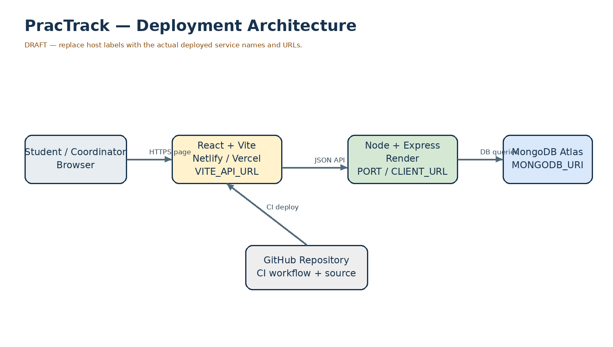

# PracTrack

PracTrack helps BSIT students record practicum hours and lets coordinators review submitted time entries against the 240-hour requirement.

## Live Links
- Frontend: Not deployed yet
- Backend health check: Not deployed yet

## Team
| Member | Role |
|---|---|
| [Member A name] | Frontend and Interface Lead |
| [Member B name] | Backend and Pipeline Lead |

## Tech Stack
| Part | Technology | Hosted on |
|---|---|---|
| Frontend | React, Vite, Vitest, React Testing Library | Netlify or Vercel (to be configured) |
| Backend | Node.js, Express, Vitest, Supertest | Render (to be configured) |
| Database | MongoDB, Mongoose | MongoDB Atlas (to be configured) |

## Run It on Your Laptop
1. Install Node.js 22 or newer and MongoDB.
2. Copy `.env.example` to `backend/.env` and `frontend/.env` as needed, then set local values.
3. In `backend/`, run `npm install`, then `npm run dev`.
4. In `frontend/`, run `npm install`, then `npm run dev`.

## Environment Variables
| Name | What it is for | Example value |
|---|---|---|
| PORT | Backend listening port | 5000 |
| MONGODB_URI | MongoDB connection string | mongodb://127.0.0.1:27017/practrack |
| CLIENT_URL | Allowed frontend origin for CORS | http://localhost:5173 |
| JWT_SECRET | Local development signing secret | local-development-only-change-me |
| VITE_API_URL | Backend URL used by the frontend | http://localhost:5000 |

## Running the Tests
- Backend: `cd backend` then `npm test` (5 required test cases are scaffolded).
- Frontend: `cd frontend` then `npm test` (3 required test cases are scaffolded).

## How CI/CD Works
GitHub Actions runs the backend and frontend checks when code is pushed to `main` or a pull request targets `main`. The backend job installs dependencies and runs its tests. The frontend job installs dependencies, runs its tests, and builds the React app. Branch protection and hosting auto-deploy settings must be configured in GitHub and the hosting dashboards before deployment is considered complete.
- Actions: https://github.com/[OWNER]/[REPOSITORY]/actions

## Diagrams

